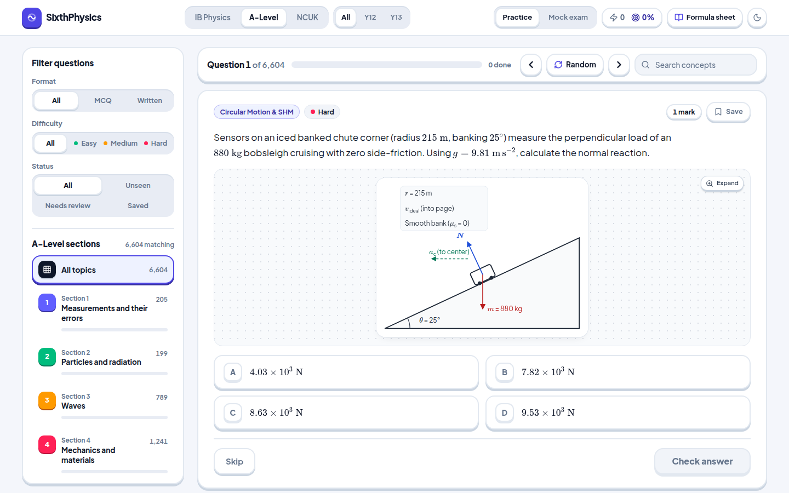
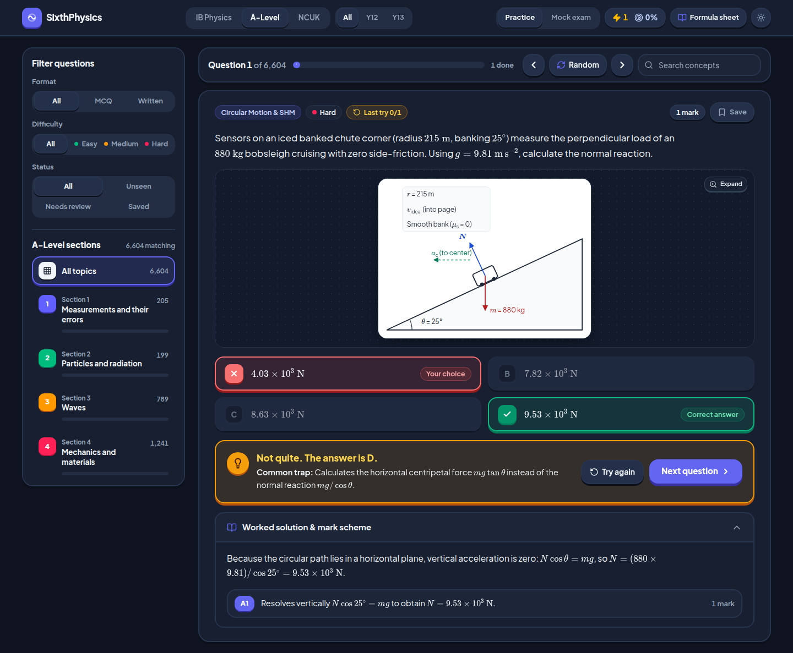
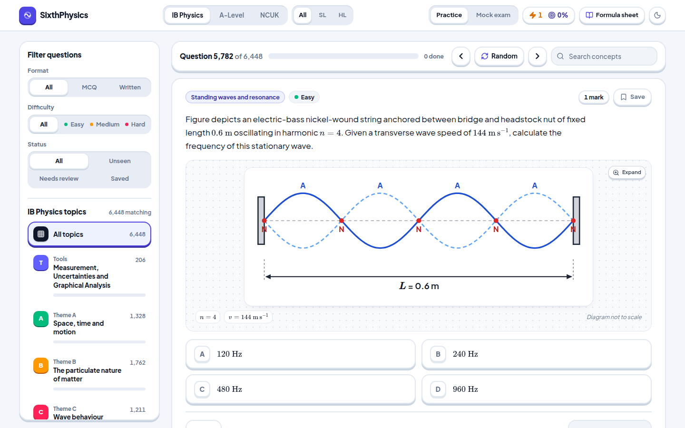
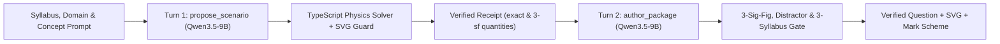

# SixthPhysics

**Neuro-symbolic pre-university physics question engine, `Qwen/Qwen3.5-9B` LoRA adapter, and 7,643-question practice bank for IB Physics (2025), UK A-Level, and NCUK IFY.**

[Live Practice App](https://sixthphysics.github.io) · [Hugging Face LoRA Model](https://huggingface.co/d4ydy/sixthphysics-qwen3.5-9b-lora) · [Hugging Face GGUF Quants](https://huggingface.co/d4ydy/sixthphysics-qwen3.5-9b-GGUF) · [Hugging Face Dataset](https://huggingface.co/datasets/d4ydy/sixthphysics-bench-and-bank) · [Model Card](docs/QWEN35_MODEL_CARD.md) · [Benchmark Report](docs/UCAS_AND_BENCHMARK_REPORT.md)



## Why SixthPhysics

General-purpose LLMs routinely hallucinate multi-step physics algebra, mix incompatible specification constants (`g = 9.8 m s^-2` on IB Physics vs `g = 9.81 m s^-2` on UK A-Level and NCUK IFY), or leak target answers inside diagrams.

SixthPhysics separates **pedagogical authoring** from **exact physical computation**. A fine-tuned [`Qwen/Qwen3.5-9B`](https://huggingface.co/d4ydy/sixthphysics-qwen3.5-9b-lora) LoRA proposes typed problem specifications, a deterministic TypeScript solver computes exact quantities and renders non-leaking SVG figures across 11 physics domains (`103` solver discriminators), and an automated verification gate enforces 3-significant-figure agreement, distractor uniqueness, mark-scheme balance, and three-syllabus compliance.

Every verified trace feeds two outputs simultaneously:

1. **Zero-API-key static study app ([sixthphysics.github.io](https://sixthphysics.github.io))** — `7,643` verified Paper 1 MCQs (`4,838`) and Paper 2 multipart structured questions (`2,805`) with deterministic SVGs, KaTeX typography, inline distractor trap callouts, interactive `M1`/`A1` self-marking chips, timed mock exams, printable PDF mock paper maker, and syllabus-specific formula sheets.
2. **Distilled neuro-symbolic physics model ([LoRA](https://huggingface.co/d4ydy/sixthphysics-qwen3.5-9b-lora) · [GGUF Quants](https://huggingface.co/d4ydy/sixthphysics-qwen3.5-9b-GGUF))** — assistant-masked `bf16` LoRA (`r=32, alpha=64`, `58.2M` trainable parameters = `0.61%`, vision tower frozen) trained on contamination-free family-grouped harness traces on Modal `NVIDIA H100 80GB HBM3`, plus merged `Q4_K_M` / `Q6_K` / `Q8_0` GGUF builds for local Ollama and `llama.cpp` inference.

## Practice Desk Preview

<table>
  <tr>
    <td width="50%">
      
      <br />
      <sub><b>Dark mode & diagnostic feedback:</b> white studio SVG plate, inline <code>Common trap</code> distractor explanation, and collapsible KaTeX worked solution.</sub>
    </td>
    <td width="50%">
      
      <br />
      <sub><b>Multi-syllabus & SVG engine:</b> instant switching across IB Physics 2025, UK A-Level, and NCUK IFY with deterministic physics figures and topic filters.</sub>
    </td>
  </tr>
</table>

## Neuro-Symbolic Architecture



- **Turn 1 (`propose_scenario`):** Emits a typed `scenarioSpec`, student-hidden unknowns (`hiddenQuantities`), and a pre-solve `questionPlan`.
- **Deterministic Solver & SVG Non-Leakage Guard:** Executes exact TypeScript physics solvers, renders student-safe SVGs guaranteed not to expose hidden unknowns, and returns `verifiedQuantities` + `formattedQuantities3sf`.
- **Turn 2 (`author_package`) & Verification Gate:** Authors the MCQ or multipart structured package conditioned on the receipt, then validates 3-sig-fig numerical match, unique distractors, exact `M1`/`A1` mark totals, and syllabus/gravity rules.

## Verified Benchmark Results (`Qwen/Qwen3.5-9B` LoRA)

All splits are strictly **family-grouped** (`175` `familyGroupKey`s: `116` train / `31` val / `28` test; `0` overlap across `itemId`, `traceId`, and concept archetypes). Champion `round1_sft_core` (`2,413` core traces) was selected strictly on held-out `val.jsonl` (`N = 645`, `80.16%` 1-retry E2E) over a Round 2 warm-start ablation before locked evaluation on `test.jsonl` (`N = 586`) and out-of-sample `Novel-1500` (`500` IB 2025, `500` UK A-Level, `500` NCUK IFY, disjoint seeds). All 22 rollout files were independently re-scored locally with `0` discrepancies.

| Benchmark & Protocol | Untuned `Qwen/Qwen3.5-9B` E2E | Champion LoRA E2E (95% Wilson CI) | Champion Syllabus Alignment (95% CI) | Gain |
| --- | ---: | --- | --- | ---: |
| **Locked `test.jsonl` — 0-Retry** (`N = 586`) | `0.00%` (`0/586`) | **`64.51%`** `[60.55%, 68.27%]` (`378/586`) | **`78.50%`** `[74.99%, 81.63%]` (`460/586`) | `+64.51 pp` |
| **Locked `test.jsonl` — 1-Retry** (`N = 586`) | `0.34%` (`2/586`) | **`75.60%`** `[71.96%, 78.90%]` (`443/586`) | **`87.03%`** `[84.07%, 89.51%]` (`510/586`) | `+75.26 pp` |
| **Locked `test.jsonl` — Teacher-Forced Step 2** (`N = 586`) | `0.68%` (`4/586`) | **`90.61%`** `[87.98%, 92.72%]` (`531/586`) | **`99.32%`** `[98.26%, 99.73%]` (`582/586`) | `+89.93 pp` |
| **`Novel-1500` Overall — 0-Retry** (`N = 1,500`) | — | **`67.53%`** `[65.12%, 69.86%]` (`1,013/1,500`) | **`84.13%`** `[82.20%, 85.89%]` (`1,262/1,500`) | — |
| **`Novel-1500` Overall — 1-Retry** (`N = 1,500`) | — | **`78.40%`** `[76.25%, 80.41%]` (`1,176/1,500`) | **`91.07%`** `[89.52%, 92.41%]` (`1,366/1,500`) | — |

**`Novel-1500` by Syllabus (1-Retry Closed-Loop):**
- **IB Physics 2025 (`N = 500`):** **`80.60%`** E2E · **`93.00%`** syllabus alignment
- **UK A-Level Physics (`N = 500`):** **`81.00%`** E2E · **`90.00%`** syllabus alignment
- **NCUK IFY Physics (`N = 500`):** **`73.60%`** E2E · **`90.20%`** syllabus alignment

> **Verification scope & honest limitations:** Syllabus alignment conservatively counts any Step 1 validation failure as unaligned; conditioned on Step-1-solved items, syllabus compliance is **`100.00%`** on locked `test.jsonl` (`510/510`) and **`99.85%`** on `Novel-1500` (`1,366/1,368`). Automated gates verify mathematical, structural, and syllabus-rule consistency rather than human classroom endorsement. An independent 15-item manual qualitative audit (`5` IB, `5` A-Level, `5` NCUK) found **`12/15`** verified outputs classroom-sound and **`3/15`** with subtle prose-to-quantity misalignments that passed 3-sf numeric gates; residual failures concentrate in `quantum-nuclear`, `thermal`, `graphs`, and multi-part `structured` items. See full stratified tables and error taxonomy in [docs/UCAS_AND_BENCHMARK_REPORT.md](docs/UCAS_AND_BENCHMARK_REPORT.md) and [docs/QWEN35_MODEL_CARD.md](docs/QWEN35_MODEL_CARD.md).

## Three-Syllabus Question Bank (`7,643` Verified Items)

Multi-syllabus crosswalk items carry specification tags for every compatible curriculum (`4,838` Paper 1 MCQs + `2,805` Paper 2 multipart structured questions; `100%` solver-verified; published at [d4ydy/sixthphysics-bench-and-bank](https://huggingface.co/datasets/d4ydy/sixthphysics-bench-and-bank)):

| Syllabus | Specification & Gravity | Tagged Items | Level & Format Breakdown | Scope |
| --- | --- | ---: | --- | --- |
| **IB Physics (2025)** | First Assessment 2025 (`g = 9.8 m s^-2`, retired 2016 options excluded) | **6,448** | `2,746` SL · `3,702` HL (`4,072` MCQ / `2,376` Structured) | Tools + Themes A–E |
| **UK A-Level Physics** | DfE / AQA 7408 core (`g = 9.81 m s^-2`) | **6,604** | `1,863` Y12 · `4,741` Y13 (`4,068` MCQ / `2,536` Structured) | Sections 1–8 + Options 9–13 |
| **NCUK IFY Physics** | `IFYPH005` (`g = 9.81 m s^-2`) | **6,193** | `2,876` IFY · `1,495` S1 · `1,822` S2 (`3,908` MCQ / `2,285` Structured) | Modules AC1–AC8 |

**11 Physics Domains (`7,643` unique items):** `fields` (756) · `mechanics` (756) · `optics-shm` (756) · `thermal` (756) · `waves` (747) · `circuits` (745) · `graphs` (740) · `grav-astro` (626) · `quantum-nuclear` (626) · `pure-calculation` (606) · `em-induction` (529).

## Generate New Questions with the Neuro-Symbolic Harness

Run the closed-loop 2-turn generator (`propose_scenario` -> deterministic TS physics solver + SVG guard -> `author_package` -> 3-sig-fig & 3-syllabus gate) locally on a fresh clone (zero `dataset/` download needed). Add `--out ./generated` to export `.json`, `.svg`, and `.md` files, or run `npm run generate:live -- --list-topics` to browse valid syllabus topics.

**1. Fastest path — Ollama GGUF `Q4_K_M` (`5.68 GB`, MacBooks & 8 GB GPUs):**

```bash
ollama pull hf.co/d4ydy/sixthphysics-qwen3.5-9b-GGUF:Q4_K_M
npm run generate:live -- --syllabus ib --level HL --topic ib-theme-c --format mcq --backend ollama --model hf.co/d4ydy/sixthphysics-qwen3.5-9b-GGUF:Q4_K_M
```

**2. OpenAI-compatible local servers (`llama-server`, LM Studio, vLLM):**

```bash
npm run generate:live -- --backend openai --base-url http://127.0.0.1:8080/v1 --model sixthphysics-qwen3.5-9b --syllabus alevel --domain circuits --format structured
```

**3. 4-bit NF4 QLoRA directly from Hugging Face (`bitsandbytes` + `peft`, ~6–7 GB VRAM):**

```bash
npm run generate:live -- --backend hf --adapter d4ydy/sixthphysics-qwen3.5-9b-lora --quant 4bit --syllabus ncuk --topic AC2 --format mcq
```

**Model & Quantization Options** ([`d4ydy/sixthphysics-qwen3.5-9b-GGUF`](https://huggingface.co/d4ydy/sixthphysics-qwen3.5-9b-GGUF) · [`d4ydy/sixthphysics-qwen3.5-9b-lora`](https://huggingface.co/d4ydy/sixthphysics-qwen3.5-9b-lora)):

| Option | Artifact | Verified Size | Est. Memory (8K ctx) | Best Hardware Fit |
| --- | --- | ---: | --- | --- |
| **`Q4_K_M`** *(default)* | [`sixthphysics-qwen3.5-9b-Q4_K_M.gguf`](https://huggingface.co/d4ydy/sixthphysics-qwen3.5-9b-GGUF/blob/main/sixthphysics-qwen3.5-9b-Q4_K_M.gguf) | `5.68 GB` (`5.29 GiB`) | ~7.5 GB RAM/VRAM | 8 GB GPUs, Apple Silicon MacBooks, Ollama |
| **`Q6_K`** | [`sixthphysics-qwen3.5-9b-Q6_K.gguf`](https://huggingface.co/d4ydy/sixthphysics-qwen3.5-9b-GGUF/blob/main/sixthphysics-qwen3.5-9b-Q6_K.gguf) | `7.36 GB` (`6.85 GiB`) | ~9.5 GB RAM/VRAM | 10–12 GB GPUs, 16 GB MacBooks (near-lossless) |
| **`Q8_0`** | [`sixthphysics-qwen3.5-9b-Q8_0.gguf`](https://huggingface.co/d4ydy/sixthphysics-qwen3.5-9b-GGUF/blob/main/sixthphysics-qwen3.5-9b-Q8_0.gguf) | `9.53 GB` (`8.87 GiB`) | ~11.5 GB RAM/VRAM | 12–16 GB GPUs, 16+ GB RAM (max GGUF precision) |
| **`4-bit NF4 + LoRA`** | [`d4ydy/sixthphysics-qwen3.5-9b-lora`](https://huggingface.co/d4ydy/sixthphysics-qwen3.5-9b-lora) | `232.8 MB` adapter | ~6–7 GB VRAM | 8+ GB NVIDIA CUDA GPUs (`bitsandbytes` + `peft`) |
| **`bf16 + LoRA`** | [`d4ydy/sixthphysics-qwen3.5-9b-lora`](https://huggingface.co/d4ydy/sixthphysics-qwen3.5-9b-lora) | `232.8 MB` adapter | ~19–22 GB VRAM | 24+ GB GPUs / H100 (exact benchmark precision) |

## Quickstart

Requires **Node.js 22+** and **npm 10+**.

```bash
git clone https://github.com/sixthphysics/sixthphysics.git
cd sixthphysics
npm ci

# Start the local practice & mock exam UI (http://127.0.0.1:3000)
npm run dev

# Export the static GitHub Pages bundle (dist-pages/)
npm run build:pages

# Run lint, TypeScript type checks, and full Jest test suite (56 suites, 772 tests)
npm run lint && npm run type-check && npm test
```

> **Static bank data:** Compiled bank chunks (`public/sixthphysics-data/`) and raw dataset splits (`dataset/`) are gitignored to keep the source repository lightweight. Download the synthetic bank and splits from [d4ydy/sixthphysics-bench-and-bank](https://huggingface.co/datasets/d4ydy/sixthphysics-bench-and-bank) or regenerate them locally via `scripts/bank-generation/`, then run `npm run compile:bank-web`. For `Qwen/Qwen3.5-9B` PEFT inference and Modal H100 LoRA training, see [training/qwen35/README.md](training/qwen35/README.md) and [docs/QWEN35_MODEL_CARD.md](docs/QWEN35_MODEL_CARD.md).

## Repository Map

| Directory / Document | Purpose |
| --- | --- |
| `app/`, `components/sixthphysics/`, `lib/sixthphysics-web/` | Next.js static practice desk, timed mock engine, KaTeX & SVG math renderer, and formula sheet |
| `lib/visuals/` | Deterministic physics solvers and non-leaking SVG engines across 11 domains |
| `lib/constants/syllabi/` | IB 2025, UK A-Level, and NCUK IFY catalogues, rules, and crosswalk definitions |
| `lib/live-generator/`, `scripts/generate-with-model.ts` | 1-command closed-loop live question generator CLI (`ollama`, `openai`, `hf` NF4) |
| `lib/bank-pipeline/`, `scripts/bank-generation/` | Multi-domain question generators, family-grouped split compiler, and schema exporter |
| `lib/benchmark/`, `scripts/benchmark/` | SixthPhysics-Bench v1.0 Step 1 solver CLI, 3-sf rollout evaluator, and `Novel-1500` generator |
| `scripts/static-site/` | Web chunk compiler (`compile:bank-web`) and GitHub Pages exporter (`build:pages`) |
| `training/qwen35/` | Modal H100 LoRA training, Modal CPU GGUF quantizer, local NF4 bridge, and report pipeline |
| `docs/QWEN35_MODEL_CARD.md`, `docs/UCAS_AND_BENCHMARK_REPORT.md` | Full Hugging Face model card, stratified CIs, ablation tables, and qualitative audit |

## License

Code is released under the [MIT License](LICENSE.md). The `Qwen/Qwen3.5-9B` LoRA adapter inherits Apache-2.0 licensing from the base model.
