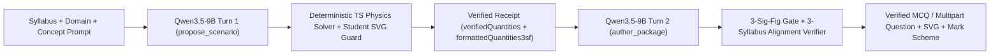

# SixthPhysics-Qwen3.5-9B-LoRA (Neuro-Symbolic Pre-University Physics Author)

## Overview

**SixthPhysics-Qwen3.5-9B-LoRA** adapts [`Qwen/Qwen3.5-9B`](https://huggingface.co/Qwen/Qwen3.5-9B) (`Qwen3_5ForConditionalGeneration`, vision tower frozen, `enable_thinking=False`) to author solver-verified examination questions inside the **SixthPhysics two-turn deterministic physics & SVG harness**.

Built alongside the **7,643-item** verified SixthPhysics static question bank (`4,838` Paper 1 MCQs and `2,805` Paper 2 multipart structured items across 11 physics domains), the promoted champion adapter (`round1_sft_core`, LoRA `r=32, alpha=64`, `58,195,968` trainable parameters = `0.6147%` of the 9.47B base model) was fine-tuned with strict assistant-only loss masking on the `2,413`-trace core training split and selected over a Round 2 warm-start polish ablation strictly on held-out `val.jsonl` (`N = 645`) prior to locked evaluation.

It targets three pre-university physics specifications simultaneously:

1. **IB Physics (First Assessment 2025)** — SL & HL, Themes A–E (`g = 9.8 m s^-2`, strict exclusion of retired IB 2016 options/topics).
2. **UK A-Level Physics (DfE / AQA 7408 core)** — AS (Year 12) & Full A-Level (Year 13) (`g = 9.81 m s^-2`).
3. **NCUK International Foundation Year (IFY) Physics (`IFYPH005`)** — Semesters 1 & 2 (`g = 9.81 m s^-2`).

## Neuro-Symbolic Architecture



In Turn 1 (`propose_scenario`), the model emits a typed `scenarioSpec` (covering `103` solver discriminators across `11` domains), student-hidden unknowns (`hiddenQuantities`), and a pre-solve `questionPlan`. A deterministic TypeScript physics engine solves the scenario, renders a student-safe SVG with zero hidden-quantity leakage, and returns exact `verifiedQuantities` + `formattedQuantities3sf`. In Turn 2 (`author_package`), the model authors the complete Paper 1 MCQ or Paper 2 structured question, distractor rationales, worked solution, and mark scheme, which are checked by deterministic numerical, structural, and three-syllabus rules.

## Headline Locked Held-Out & Out-of-Sample Results

Champion selection (`round1_sft_core`) was locked **strictly on held-out `val.jsonl` (`645` items, SHA-256 `a094cab46b48ea1c08300ed172fc13d8660a0a1cc5fe1021e273552d1ac6c846`)** before evaluating on locked `test.jsonl` (`586` items, `28` unseen `familyGroupKey`s, SHA-256 `fd6888e53f0c98ccd0b5f792e1f6bf223f6067ef400b270dd2cb9463310b1252`) and out-of-sample `Novel-1500` (`1,500` fresh prompts: `500` IB 2025, `500` UK A-Level, `500` NCUK IFY, disjoint seeds `90000001..90001500`). All percentages and 95% Wilson CIs were independently re-scored locally via `npx tsx scripts/benchmark/evaluate-model-rollouts.ts` (`22/22` reports matched with `0` discrepancies).

| Split & Protocol | Step 1 Solver Pass (95% Wilson CI) | Step 2 Gate Pass (95% Wilson CI) | Syllabus Aligned (95% Wilson CI) | End-to-End Verified (95% Wilson CI) | Conditional Step 2 |
| --- | --- | --- | --- | --- | ---: |
| Untuned `Qwen/Qwen3.5-9B` — Locked Test 0-Retry (N=586) | 13.82% [11.26%, 16.85%] (81/586) | 3.92% [2.63%, 5.82%] (23/586) | 2.73% [1.69%, 4.39%] (16/586) | 0.00% [0.00%, 0.65%] (0/586) | 28.40% |
| Untuned `Qwen/Qwen3.5-9B` — Locked Test 1-Retry (N=586) | 17.92% [15.03%, 21.23%] (105/586) | 4.95% [3.47%, 7.02%] (29/586) | 4.95% [3.47%, 7.02%] (29/586) | 0.34% [0.09%, 1.24%] (2/586) | 27.62% |
| Untuned `Qwen/Qwen3.5-9B` — Locked Test TF Step 2 (N=586) | 100.00% [99.35%, 100.00%] (586/586) | 12.12% [9.72%, 15.01%] (71/586) | 59.21% [55.19%, 63.12%] (347/586) | 0.68% [0.27%, 1.74%] (4/586) | 12.12% |
| **Champion (`round1_sft_core`) — Locked Test 0-Retry (N=586)** | **78.50%** [74.99%, 81.63%] (460/586) | **64.51%** [60.55%, 68.27%] (378/586) | **78.50%** [74.99%, 81.63%] (460/586) | **64.51%** [60.55%, 68.27%] (378/586) | **82.17%** |
| **Champion (`round1_sft_core`) — Locked Test 1-Retry (N=586)** | **87.03%** [84.07%, 89.51%] (510/586) | **75.60%** [71.96%, 78.90%] (443/586) | **87.03%** [84.07%, 89.51%] (510/586) | **75.60%** [71.96%, 78.90%] (443/586) | **86.86%** |
| **Champion (`round1_sft_core`) — Locked Test TF Step 2 (N=586)** | **100.00%** [99.35%, 100.00%] (586/586) | **90.79%** [88.17%, 92.87%] (532/586) | **99.32%** [98.26%, 99.73%] (582/586) | **90.61%** [87.98%, 92.72%] (531/586) | **90.79%** |
| **Champion (`round1_sft_core`) — Novel-1500 0-Retry (N=1500)** | **84.13%** [82.20%, 85.89%] (1262/1500) | **67.53%** [65.12%, 69.86%] (1013/1500) | **84.13%** [82.20%, 85.89%] (1262/1500) | **67.53%** [65.12%, 69.86%] (1013/1500) | **80.27%** |
| **Champion (`round1_sft_core`) — Novel-1500 1-Retry (N=1500)** | **91.20%** [89.66%, 92.53%] (1368/1500) | **78.40%** [76.25%, 80.41%] (1176/1500) | **91.07%** [89.52%, 92.41%] (1366/1500) | **78.40%** [76.25%, 80.41%] (1176/1500) | **85.96%** |

- **Locked `test.jsonl` End-to-End Solver-Verified jump:** `0.00%` -> **`64.51%`** (`+64.51 pp`, 0-retry) and `0.34%` -> **`75.60%`** (`+75.26 pp`, 1-retry).
- **Conservative Syllabus Alignment definition:** `evaluate-model-rollouts.ts` marks `syllabusAligned = false` whenever Step 1 fails validation. Conditioned on Step-1-solved scenarios, syllabus-rule compliance is **`100.00%`** on locked `test.jsonl` (`460/460` 0-retry, `510/510` 1-retry; `0` violations) and **`99.85%`** on `Novel-1500` 1-retry (`1,366/1,368`; only `2` NCUK paper-mark bound mismatches).

## Multi-Round Progression on Held-Out `val.jsonl` (`N = 645`)

| Round & Protocol (`val.jsonl`) | Step 1 Solver Pass (95% CI) | Step 2 Gate Pass (95% CI) | Syllabus Aligned (95% CI) | End-to-End Verified (95% CI) | Conditional Step 2 |
| --- | --- | --- | --- | --- | ---: |
| Round 0: Untuned `Qwen/Qwen3.5-9B` — 0-Retry (N=645) | 27.75% [24.44%, 31.33%] (179/645) | 1.40% [0.74%, 2.63%] (9/645) | 11.16% [8.96%, 13.83%] (72/645) | 0.00% [0.00%, 0.59%] (0/645) | 5.03% |
| Round 0: Untuned `Qwen/Qwen3.5-9B` — 1-Retry (N=645) | 35.19% [31.61%, 38.96%] (227/645) | 7.60% [5.79%, 9.90%] (49/645) | 10.70% [8.54%, 13.32%] (69/645) | 1.71% [0.95%, 3.03%] (11/645) | 21.59% |
| Round 0: Untuned `Qwen/Qwen3.5-9B` — TF Step 2 (N=645) | 100.00% [99.41%, 100.00%] (645/645) | 12.87% [10.50%, 15.67%] (83/645) | 50.08% [46.23%, 53.92%] (323/645) | 0.78% [0.33%, 1.80%] (5/645) | 12.87% |
| **Round 1: SFT Core — 0-Retry (`r=32`, 2,413 traces) (N=645)** | 94.57% [92.55%, 96.07%] (610/645) | 69.92% [66.27%, 73.34%] (451/645) | 94.26% [92.19%, 95.81%] (608/645) | 69.92% [66.27%, 73.34%] (451/645) | 73.93% |
| **Round 1: SFT Core — 1-Retry (`r=32`, 2,413 traces) (N=645)** | 95.81% [93.98%, 97.11%] (618/645) | **80.16%** [76.90%, 83.05%] (517/645) | 95.50% [93.62%, 96.85%] (616/645) | **80.16%** [76.90%, 83.05%] (517/645) | **83.66%** |
| Round 1: SFT Core — TF Step 2 (N=645) | 100.00% [99.41%, 100.00%] (645/645) | 88.22% [85.50%, 90.48%] (569/645) | 99.38% [98.42%, 99.76%] (641/645) | 87.60% [84.83%, 89.92%] (565/645) | 88.22% |
| Round 2: Warm-Start Polish (`60` steps) — 0-Retry (N=645) | 94.42% [92.37%, 95.94%] (609/645) | **74.11%** [70.59%, 77.34%] (478/645) | 94.42% [92.37%, 95.94%] (609/645) | **74.11%** [70.59%, 77.34%] (478/645) | 78.49% |
| Round 2: Warm-Start Polish (`60` steps) — 1-Retry (N=645) | 95.66% [93.80%, 96.98%] (617/645) | 79.69% [76.41%, 82.61%] (514/645) | 95.50% [93.62%, 96.85%] (616/645) | 79.69% [76.41%, 82.61%] (514/645) | 83.31% |
| Round 2: Warm-Start Polish (`60` steps) — TF Step 2 (N=645) | 100.00% [99.41%, 100.00%] (645/645) | **89.61%** [87.02%, 91.74%] (578/645) | **99.53%** [98.64%, 99.84%] (642/645) | **89.46%** [86.85%, 91.60%] (577/645) | **89.61%** |

- **Ablation Takeaway:** Round 2 warm-start polish (upsampling Paper 2 structured items and weaker domains from `train_r2_expanded.jsonl`) improved single-shot 0-retry E2E (`69.92%` -> `74.11%`, `+4.19 pp`), Paper 2 structured 0-retry E2E (`51.83%` -> `61.01%`, `+9.18 pp`), and Teacher-Forced Step 2 (`87.60%` -> `89.46%`), at the cost of a small `-2.34 pp` dip in 1-retry MCQ E2E (`90.63%` -> `88.29%`) that left overall 1-retry E2E at `79.69%` vs Round 1's `80.16%`. Per the pre-registered `(val_one_retry_e2e, val_zero_retry_e2e)` rule, `round1_sft_core` retained the champion slot. A planned Round 3 online RFT/DPO pass was deferred to preserve Modal H100 compute budget.

## Stratified Three-Syllabus Performance

### Top-Level Syllabus Comparison (`Novel-1500`, `N = 500` per Syllabus)

| Syllabus (Protocol) | N | Step 1 Solver Pass (95% CI) | Step 2 Gate Pass (95% CI) | Syllabus Aligned (95% CI) | End-to-End Verified (95% CI) | Conditional Step 2 |
| --- | ---: | --- | --- | --- | --- | ---: |
| **IB Physics 2025** (0-Retry) | 500 | 83.60% [80.10%, 86.59%] (418/500) | 69.00% [64.81%, 72.90%] (345/500) | 83.60% [80.10%, 86.59%] (418/500) | 69.00% [64.81%, 72.90%] (345/500) | 82.54% |
| **UK A-Level Physics** (0-Retry) | 500 | 84.60% [81.17%, 87.50%] (423/500) | 69.80% [65.64%, 73.66%] (349/500) | 84.60% [81.17%, 87.50%] (423/500) | 69.80% [65.64%, 73.66%] (349/500) | 82.51% |
| **NCUK IFY Physics** (0-Retry) | 500 | 84.20% [80.74%, 87.13%] (421/500) | 63.80% [59.50%, 67.89%] (319/500) | 84.20% [80.74%, 87.13%] (421/500) | 63.80% [59.50%, 67.89%] (319/500) | 75.77% |
| **IB Physics 2025** (1-Retry) | 500 | 93.00% [90.42%, 94.92%] (465/500) | 80.60% [76.91%, 83.83%] (403/500) | 93.00% [90.42%, 94.92%] (465/500) | **80.60%** [76.91%, 83.83%] (403/500) | 86.67% |
| **UK A-Level Physics** (1-Retry) | 500 | 90.00% [87.06%, 92.33%] (450/500) | 81.00% [77.33%, 84.20%] (405/500) | 90.00% [87.06%, 92.33%] (450/500) | **81.00%** [77.33%, 84.20%] (405/500) | 90.00% |
| **NCUK IFY Physics** (1-Retry) | 500 | 90.60% [87.72%, 92.86%] (453/500) | 73.60% [69.57%, 77.27%] (368/500) | 90.20% [87.28%, 92.51%] (451/500) | **73.60%** [69.57%, 77.27%] (368/500) | 81.24% |

### Granular Syllabus & Level Breakdown (`Novel-1500`, 1-Retry Closed-Loop)

| Syllabus :: Level | N | Step 1 Solver Pass (95% CI) | Step 2 Gate Pass (95% CI) | Syllabus Aligned (95% CI) | End-to-End Verified (95% CI) |
| --- | ---: | --- | --- | --- | --- |
| `alevel:Y12` | 104 | 88.46% [80.91%, 93.27%] (92/104) | 79.81% [71.10%, 86.40%] (83/104) | 88.46% [80.91%, 93.27%] (92/104) | 79.81% [71.10%, 86.40%] (83/104) |
| `alevel:Y13` | 396 | 90.40% [87.10%, 92.93%] (358/396) | 81.31% [77.18%, 84.84%] (322/396) | 90.40% [87.10%, 92.93%] (358/396) | 81.31% [77.18%, 84.84%] (322/396) |
| `ib:HL` | 353 | 91.50% [88.13%, 93.98%] (323/353) | 77.90% [73.29%, 81.92%] (275/353) | 91.50% [88.13%, 93.98%] (323/353) | 77.90% [73.29%, 81.92%] (275/353) |
| `ib:SL` | 147 | 96.60% [92.29%, 98.54%] (142/147) | 87.07% [80.69%, 91.57%] (128/147) | 96.60% [92.29%, 98.54%] (142/147) | 87.07% [80.69%, 91.57%] (128/147) |
| `ncuk:IFY` | 351 | 90.03% [86.45%, 92.74%] (316/351) | 70.37% [65.39%, 74.91%] (247/351) | 89.46% [85.81%, 92.26%] (314/351) | 70.37% [65.39%, 74.91%] (247/351) |
| `ncuk:IFY-S1` | 76 | 97.37% [90.90%, 99.28%] (74/76) | 85.53% [75.91%, 91.72%] (65/76) | 97.37% [90.90%, 99.28%] (74/76) | 85.53% [75.91%, 91.72%] (65/76) |
| `ncuk:IFY-S2` | 73 | 86.30% [76.59%, 92.39%] (63/73) | 76.71% [65.83%, 84.92%] (56/73) | 86.30% [76.59%, 92.39%] (63/73) | 76.71% [65.83%, 84.92%] (56/73) |

### Locked `test.jsonl` by Syllabus & Level (Champion, 1-Retry Closed-Loop)

> Note: Multi-syllabus crosswalk items in `test.jsonl` carry tags for each compatible curriculum (`IB: 515`, `UK A-Level: 494`, `NCUK IFY: 503` tagged occurrences across `586` unique items).

| Syllabus / Level | N | Step 1 Solver Pass (95% CI) | Step 2 Gate Pass (95% CI) | Syllabus Aligned (95% CI) | End-to-End Verified (95% CI) |
| --- | ---: | --- | --- | --- | --- |
| **IB Physics 2025 (all)** | 515 | 86.60% [83.39%, 89.27%] (446/515) | 74.56% [70.63%, 78.13%] (384/515) | 86.60% [83.39%, 89.27%] (446/515) | 74.56% [70.63%, 78.13%] (384/515) |
| **UK A-Level Physics (all)** | 494 | 85.02% [81.60%, 87.90%] (420/494) | 72.27% [68.16%, 76.03%] (357/494) | 85.02% [81.60%, 87.90%] (420/494) | 72.27% [68.16%, 76.03%] (357/494) |
| **NCUK IFY Physics (all)** | 503 | 84.89% [81.50%, 87.76%] (427/503) | 72.56% [68.51%, 76.28%] (365/503) | 84.89% [81.50%, 87.76%] (427/503) | 72.56% [68.51%, 76.28%] (365/503) |
| `alevel:Y12` | 194 | 77.32% [70.93%, 82.65%] (150/194) | 65.46% [58.53%, 71.80%] (127/194) | 77.32% [70.93%, 82.65%] (150/194) | 65.46% [58.53%, 71.80%] (127/194) |
| `alevel:Y13` | 300 | 90.00% [86.08%, 92.91%] (270/300) | 76.67% [71.56%, 81.10%] (230/300) | 90.00% [86.08%, 92.91%] (270/300) | 76.67% [71.56%, 81.10%] (230/300) |
| `ib:HL` | 322 | 89.75% [85.96%, 92.61%] (289/322) | 74.53% [69.51%, 78.98%] (240/322) | 89.75% [85.96%, 92.61%] (289/322) | 74.53% [69.51%, 78.98%] (240/322) |
| `ib:SL` | 193 | 81.35% [75.26%, 86.21%] (157/193) | 74.61% [68.03%, 80.23%] (144/193) | 81.35% [75.26%, 86.21%] (157/193) | 74.61% [68.03%, 80.23%] (144/193) |
| `ncuk:IFY` | 192 | 84.90% [79.15%, 89.27%] (163/192) | 76.04% [69.53%, 81.53%] (146/192) | 84.90% [79.15%, 89.27%] (163/192) | 76.04% [69.53%, 81.53%] (146/192) |
| `ncuk:IFY-S1` | 86 | 91.86% [84.14%, 96.00%] (79/86) | 79.07% [69.32%, 86.33%] (68/86) | 91.86% [84.14%, 96.00%] (79/86) | 79.07% [69.32%, 86.33%] (68/86) |
| `ncuk:IFY-S2` | 225 | 82.22% [76.70%, 86.66%] (185/225) | 67.11% [60.73%, 72.92%] (151/225) | 82.22% [76.70%, 86.66%] (185/225) | 67.11% [60.73%, 72.92%] (151/225) |

### Domain & Paper-Format Summary (Champion, 1-Retry Closed-Loop)

| Domain / Format | Locked Test `N` | Locked Test E2E (95% CI) | `Novel-1500` `N` | `Novel-1500` E2E (95% CI) |
| --- | ---: | --- | ---: | --- |
| `circuits` | 65 | 100.00% [94.42%, 100.00%] (65/65) | 114 | 85.09% [77.41%, 90.48%] (97/114) |
| `em-induction` | 20 | 100.00% [83.89%, 100.00%] (20/20) | 114 | 84.21% [76.42%, 89.77%] (96/114) |
| `pure-calculation` | 42 | 95.24% [84.21%, 98.68%] (40/42) | 48 | 100.00% [92.59%, 100.00%] (48/48) |
| `grav-astro` | 63 | 93.65% [84.78%, 97.50%] (59/63) | 136 | 90.44% [84.33%, 94.33%] (123/136) |
| `mechanics` | 42 | 90.48% [77.93%, 96.23%] (38/42) | 236 | 83.90% [78.67%, 88.04%] (198/236) |
| `optics-shm` | 42 | 83.33% [69.40%, 91.68%] (35/42) | 127 | 81.10% [73.42%, 86.96%] (103/127) |
| `waves` | 41 | 82.93% [68.74%, 91.47%] (34/41) | 158 | 82.28% [75.58%, 87.44%] (130/158) |
| `fields` | 84 | 80.95% [71.28%, 87.92%] (68/84) | 64 | 90.62% [81.02%, 95.63%] (58/64) |
| `thermal` | 63 | 53.97% [41.79%, 65.69%] (34/63) | 139 | 67.63% [59.46%, 74.84%] (94/139) |
| `quantum-nuclear` | 84 | 42.86% [32.82%, 53.52%] (36/84) | 287 | 59.93% [54.17%, 65.43%] (172/287) |
| `graphs` | 40 | 35.00% [22.13%, 50.49%] (14/40) | 77 | 74.03% [63.26%, 82.51%] (57/77) |
| **Paper 1 MCQ (`mcq`)** | 375 | **79.47%** [75.09%, 83.25%] (298/375) | 975 | **83.90%** [81.46%, 86.07%] (818/975) |
| **Paper 2 Structured (`structured`)** | 211 | **68.72%** [62.18%, 74.59%] (145/211) | 525 | **68.19%** [64.09%, 72.03%] (358/525) |

## Training Curriculum & Zero-Contamination Audit

- **Hardware:** NVIDIA H100 80GB HBM3 (`79.17 GiB` VRAM, Modal Cloud); peak training VRAM `30.16 GiB`.
- **Adapter Specification:** `peft` LoRA (`r=32`, `lora_alpha=64`, `lora_dropout=0.05`) on all 7 attention/MLP linear projections (`q_proj`, `k_proj`, `v_proj`, `o_proj`, `gate_proj`, `up_proj`, `down_proj`), excluding vision and MTP modules (`.*(visual|mtp).*`; `0` visual tensors in `adapter_model.safetensors`, `256` tensors, `58,195,968` trainable parameters, `0` NaN/Inf).
- **Strict Assistant-Only Loss Masking:** `labels = -100` on all `system` (including code-derived compact domain tool schemas), `user`, and `tool` receipt tokens; sparse `lm_head` cross-entropy is computed exclusively over Step 1 and Step 2 assistant JSON spans up to `<|im_end|>`.
- **Round 1 (`round1_sft_core`, Champion):** `bf16` LoRA, `lr=2e-4` cosine, 3 epochs (`453` optimizer steps, loss `0.6618` -> `0.0509`) on the `2,413`-trace core `train` split (`116` family groups).
- **Round 2 (`round2_warm_polish`, Ablation):** Warm-started from `round1_sft_core/adapter`, `lr=3.5e-5` cosine, `60` optimizer steps (`960` examples seen from an error-targeted `1,600`-trace subset of `train_r2_expanded.jsonl`, loss `0.0585` -> `0.0410`).
- **Zero Contamination Verified:** Programmatic audit verified **0 overlap** on `itemId`, `traceId`, and `familyGroupKey` between all training splits (`2,413` core / `6,412` expanded) and held-out `val.jsonl` (`645`, `31` groups), locked `test.jsonl` (`586`, `28` groups), and `Novel-1500` (`1,500`).

## Usage (PEFT + Transformers)

```python
import json
import subprocess
import torch
from peft import PeftModel
from transformers import AutoModelForImageTextToText, AutoTokenizer

base_id = "Qwen/Qwen3.5-9B"
adapter_dir = "dataset/qwen35-9b-runs/champion-adapter"  # or your Hugging Face Hub repo ID

tokenizer = AutoTokenizer.from_pretrained(base_id)
base_model = AutoModelForImageTextToText.from_pretrained(
    base_id, dtype=torch.bfloat16, device_map="auto"
)
model = PeftModel.from_pretrained(base_model, adapter_dir)
model.eval()


def generate_turn(messages: list[dict[str, str]], max_new_tokens: int = 1200) -> str:
    prompt = tokenizer.apply_chat_template(
        messages, tokenize=False, add_generation_prompt=True, enable_thinking=False
    )
    inputs = tokenizer(prompt, return_tensors="pt").to(model.device)
    with torch.no_grad():
        out = model.generate(
            **inputs,
            max_new_tokens=max_new_tokens,
            do_sample=False,
            pad_token_id=tokenizer.eos_token_id,
        )
    return tokenizer.decode(out[0][inputs["input_ids"].shape[1]:], skip_special_tokens=True)


# Turn 1: propose structured scenarioSpec + hiddenQuantities + questionPlan
messages = [
    {"role": "system", "content": system_prompt_with_domain_tool_schema},
    {"role": "user", "content": json.dumps(target_syllabus_prompt)},
]
step1_json = generate_turn(messages, max_new_tokens=900)

# Deterministic TypeScript physics solver + student SVG non-leakage check
# (via scripts/benchmark/solve-step1-batch.ts) returns `tool_receipt_json`
messages.append({"role": "assistant", "content": step1_json})
messages.append({"role": "tool", "content": tool_receipt_json})

# Turn 2: author final Paper 1 MCQ or Paper 2 structured package grounded in verifiedQuantities
step2_json = generate_turn(messages, max_new_tokens=1400)
```

## Evaluation Boundaries, Qualitative Spot-Check & Limitations

- **Automated Verification Scope:** Deterministic solver verification, 3-significant-figure numerical agreement, student SVG hidden-quantity non-leakage checks, and automated syllabus/gravity rule checks establish **mathematical, structural, and specification consistency**. They do **not** substitute for human teacher sign-off on classroom pedagogy or examination board endorsement.
- **Independent 15-Question Qualitative Audit:** Manual inspection of 15 verified champion outputs (`5` IB 2025, `5` UK A-Level, `5` NCUK IFY across all 11 domains, mixing MCQ and Structured from locked `test.jsonl` and `Novel-1500`) found **12/15** fully sound in prose, physics, distractor rationales, and mark schemes, and **3/15** with subtle prose-to-quantity semantic misalignments that passed numeric 3-sf solver matching (e.g., framing a linear gradient solver receipt as a `log10 A` plot in `sp-graphs-0024-mcq`, asking for cable force components while quoting `accelerationMs2` in `novel-ncuk-0036` part (a), and quoting liquid-heating energy alone for a combined melt+heat prompt in `sp-thermal-struct-0011` part (b)).
- **Residual Failure Concentrations:** Unseen-family Step 1 failures concentrate in schema-strict domains (`quantum-nuclear` transition level-ID formatting and `thermal` phase/heat-capacity validation), while Step 2 failures concentrate in `graphs` and multi-part `structured` items (`ground-truth-mismatch` and `mark-sum-mismatch`).
- **Verification Environment Note:** All weights and rollouts were verified on Modal H100 (`vLLM` + `bfloat16`); local adapter safetensors integrity (`256` tensors, `0` NaN/Inf) and all `22/22` benchmark reports were independently verified on CPU while the local workstation operated in iGPU (`uni-battery`) mode.
